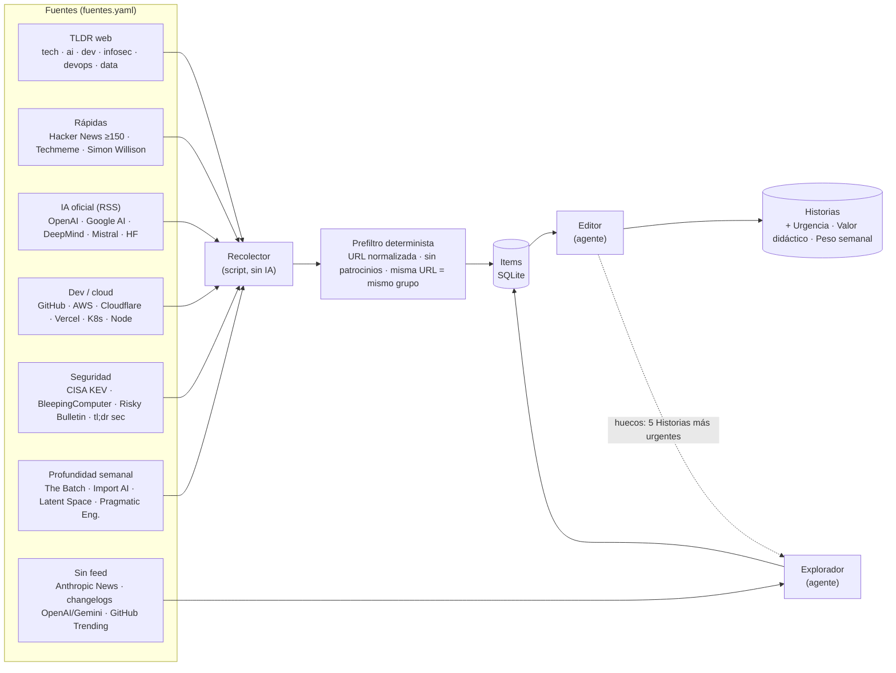
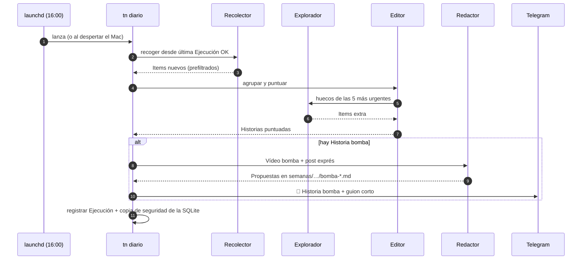
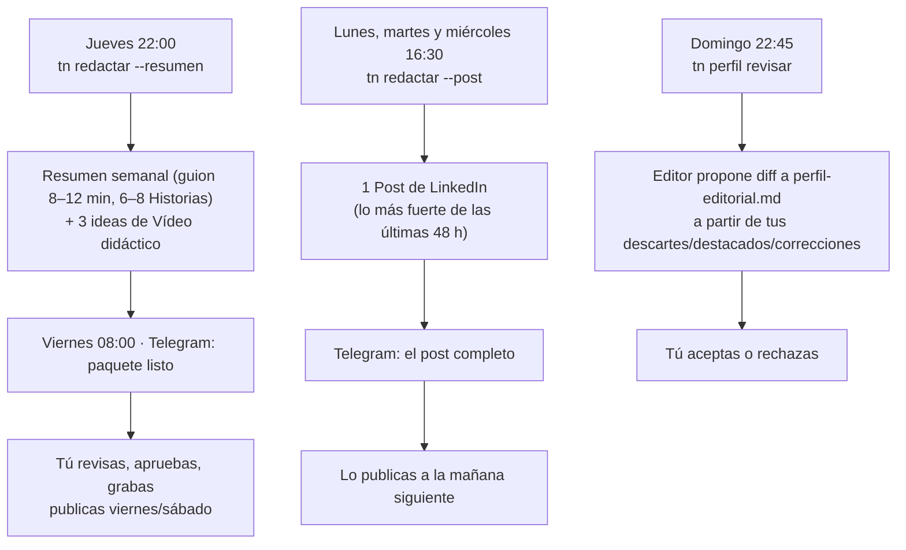
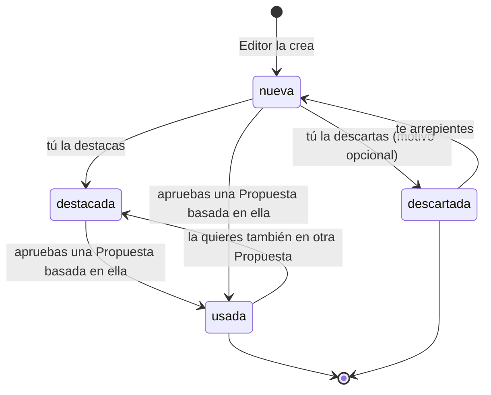
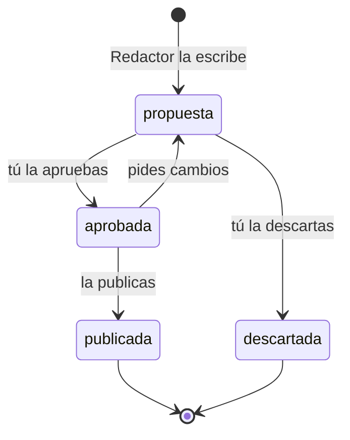
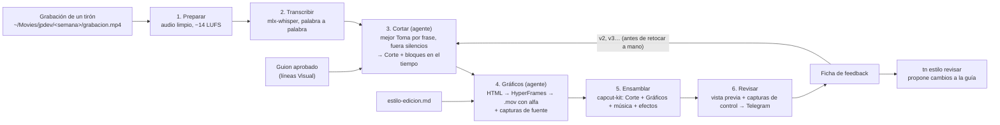

# El arnés de tech-news

Fuente de verdad de **cómo funciona el sistema**: qué entra, quién lo procesa, cuándo, qué sale y cómo intervienes tú. El vocabulario está en [GLOSSARY.md](../GLOSSARY.md) y las decisiones de fondo en [docs/adr/](adr/). Si algo de aquí deja de ser cierto, se corrige aquí primero.

Vista visual (canvas): [Arnés tech-news](https://claude.ai/artifact/FSAwQQcw4d2sJ8ghapZCgk). Si discrepa de este documento, manda este documento.

> Estado: **diseño cerrado, nada construido todavía.** Los nombres de comandos son los previstos y pueden ajustarse al implementar; si cambian, se cambian aquí.

## 1. Visión en una frase

Cada día el sistema recoge lo publicado en ~25 Fuentes, lo agrupa en Historias y las puntúa contra tu Perfil editorial; cada semana convierte las mejores en Propuestas (guiones y posts) que tú apruebas, grabas y publicas. Nada se publica sin ti.

| Fase | Qué cubre | Estado |
|---|---|---|
| **1** | Recoger → Historias → Propuestas (guiones, posts) + interfaz web + avisos | Por construir |
| **2** | Montaje del vídeo: el Montador convierte guion + tu Grabación en un Montaje de CapCut | Diseñado (§9), por construir |
| **3** | Creación del canal de YouTube (nombre, identidad, configuración) | Pendiente |

## 2. Mapa de entradas



Reglas de entrada:
- **Web/RSS primero.** Gmail queda fuera de la v1 ([ADR-0001](adr/0001-recoleccion-hibrida-scripts-y-agente.md)).
- **Recolector y Explorador solo añaden Items**; nunca interpretan. Editor y Redactor solo interpretan; nunca recogen. Así se puede re-procesar una semana entera sin volver a recoger.
- **Recogida "desde la última Ejecución con éxito"**, no "últimas 24 h": si el Mac estuvo apagado, el hueco se rellena solo ([ADR-0002](adr/0002-ejecucion-local-sin-despliegue.md)).
- Detalle de cada Fuente y cómo leerla: [docs/research/fuentes.md](research/fuentes.md).

## 3. Roles

| Rol | Tipo | Entrada | Salida | Gasta cuota Claude |
|---|---|---|---|---|
| **Recolector** | Script Python | `fuentes.yaml` | Items (prefiltrados) | No |
| **Explorador** | Skill de Claude Code | Lista fija sin feed + 5 Historias más urgentes | Items | Sí (acotado) |
| **Editor** | Skill de Claude Code | Items nuevos + `perfil-editorial.md` | Historias puntuadas, aviso de Historia bomba | Sí |
| **Redactor** | Skill de Claude Code | Historias de la Semana editorial + `voz.md` | Propuestas en `semanas/` | Sí |
| **Montador** | Fase 2: CLI + skill de Claude Code | Guion aprobado + tu Grabación | Montaje de CapCut | Sí (Corte y Gráficos) |

Tareas cerradas del **Explorador** cada día:
1. Revisar las Fuentes sin feed: Anthropic News, changelog API OpenAI, changelog API Gemini, GitHub Trending.
2. Para las 5 Historias con más Urgencia del día, buscar anuncio oficial o fuente primaria que aún no tengamos.

Trabajo del **Editor** en cada Ejecución:
1. Agrupar Items nuevos: sumar a una Historia abierta o crear una nueva.
2. Leer la fuente original solo de las Historias candidatas (~10–15/día).
3. Puntuar Urgencia, Valor didáctico y Peso semanal, con una línea de justificación cada una.
4. Si alguna Historia es bomba → Redactor exprés (Vídeo bomba + post) y aviso por Telegram.

## 4. Flujos

### 4.1 Diario (16:00)



### 4.2 Semanal



### 4.3 Historia bomba

Se detecta en la Ejecución diaria (máximo un día de retraso, [ADR-0002](adr/0002-ejecucion-local-sin-despliegue.md)). Si ves algo gordo antes, lánzalo tú: `tn diario` o, para una Historia concreta, `tn propuesta pedir <historia> --formato bomba`.

## 5. Horarios

Seis tareas de `launchd` (LaunchAgents en `~/Library/LaunchAgents/com.jpdev.tech-news.*`). Cada una llama a `tn programado <tarea>`, que espera si ya hay algo en curso, ejecuta y, si falla, avisa por Telegram. La salida queda en `data/registros/horario-<tarea>.log`.

| Cuándo | Tarea | Qué hace | Aviso |
|---|---|---|---|
| Diario 16:00 | `diario` | Recolector → Editor (máx. 200 Items, `TN_MAX_ITEMS_DIARIO`) → Explorador → Editor → Vídeo bomba si procede → copia de seguridad | 💥 al momento si hay Historia bomba |
| Lunes, martes y miércoles 16:30 | `post-diario` | `tn redactar --post`: un post sobre lo más fuerte de las **últimas 48 h** sin post esta semana | ✍️ El post completo, para publicarlo a la mañana siguiente |
| Jueves 22:00 | `resumen` | `tn redactar --resumen --didactico` | — |
| Viernes 08:00 | `aviso-paquete` | — | 📦 Resumen semanal e ideas listos, con el gancho |
| Domingo 22:45 | `perfil` | `tn perfil revisar` (solo si hay ≥ 3 correcciones nuevas) | 🧭 si hay propuesta de cambios |

Gestión: `tn horarios instalar | desinstalar | estado | lanzar <tarea>` y `tn diagnostico [--claude]`.

### Puesta en marcha (una vez)

1. Crea un bot con @BotFather en Telegram y pon su token en `.env` como `TN_TELEGRAM_TOKEN=…` (plantilla en `.env.example`).
2. Escríbele cualquier cosa al bot y ejecuta `uv run tn avisos vincular`; prueba con `uv run tn avisos prueba`.
3. `uv run tn horarios instalar` y comprueba con `uv run tn diagnostico --claude`.

La copia de seguridad diaria (SQLite + `semanas/` + perfil, voz y fuentes) va a `~/Documents/tech-news-respaldos` (o `TN_RESPALDOS`) y se conservan las 14 últimas. A mano: `uv run tn respaldar`.

**Semana editorial:** de viernes a jueves. La carpeta de una semana se nombra por su viernes de inicio: `semanas/2026-11-20/` contiene los posts entregados el lunes 23 y el Resumen semanal entregado el viernes 27.

Si el Mac duerme a la hora programada, `launchd` lanza la tarea al despertar. Ningún horario es obligatorio: todo se puede lanzar a mano (§7).

## 6. Ciclos de vida

### Historia



- Una Historia sigue **abierta 7 días** desde su último Item; lo que llegue en ese plazo se suma. Después, una continuación es una Historia nueva **enlazada** a la anterior ("seguimiento de…").
- Correcciones posibles en cualquier estado: ajustar una puntuación, fusionar dos Historias, separar una en dos.

### Propuesta



Las ideas de Vídeo didáctico se proponen como esquema; el guion completo solo se escribe al aprobar una (ahorra cuota).

## 7. Cómo intervienes tú

Toda acción pasa por la CLI `tn` ([ADR-0004](adr/0004-cli-unica-como-punto-de-entrada.md)). La web y yo (Claude Code) somos clientes de esa CLI: **pedírmelo hablando es exactamente lo mismo que pulsar el botón**, y queda registrado igual.

| Quiero… | CLI | Hablando con Claude Code | Web local (`tn ui`) |
|---|---|---|---|
| Lanzar el día ahora | `tn diario` | `/recoger` o "lanza el día" | Ejecuciones → Lanzar |
| Solo recoger / editar / explorar | `tn recoger` · `tn editar [--max-items N]` · `tn explorar` | "recoge" · "re-edita lo de hoy" | Ejecuciones |
| Ver Historias del día/semana | `tn historias --dias 1` · `tn historias` (7 días) · `tn historia ver <id>` | "¿qué hay hoy?" | Hoy / Semana |
| Descartar una Historia | `tn historia descartar <id> --motivo …` | "descarta la de X, ya está muy contada" | Botón Descartar |
| Destacar una Historia | `tn historia destacar <id>` | "esta tiene que ir sí o sí" | Botón Destacar |
| Corregir una puntuación | `tn historia puntuar <id> --didactico 8` | "esto da para vídeo didáctico" | Editar puntuación |
| Fusionar / separar | `tn historia fusionar <a> <b>` · `tn historia separar <id> --items 3,4 --titulo …` | "estas dos son la misma" | Fusionar / Separar |
| Propuesta fuera de calendario | `tn propuesta pedir <id> --formato …` | "hazme un post de esto ya" | Pedir Propuesta |
| Generar el paquete semanal o un post antes | `tn redactar --resumen` · `tn redactar --post` | `/redactar` | Ejecuciones |
| Ver / aprobar / descartar una Propuesta | `tn propuestas` · `tn propuesta ver <fichero>` · `tn propuesta estado <fichero> aprobada` | "apruebo el post 2" | Propuestas |
| Revisar la semana con criterio | — | `/revisar-semana` | — |
| Afinar el Perfil editorial | `tn perfil revisar` · `tn perfil diff` · `tn perfil aceptar`/`rechazar` | "esta semana sobraba cripto" | — |
| Ver qué ha fallado | `tn ejecuciones` | "¿qué tal fue la última ejecución?" | Ejecuciones / Fuentes |

Toda acción acepta `--origen manual|horario|claude|web` para que el registro diga quién la lanzó (`tn` usa `manual` por defecto; yo uso `claude`). Las correcciones sobre Historias (descartar, destacar, restaurar, puntuar, fusionar, separar) quedan guardadas como decisiones, que alimentan `tn perfil revisar`.

Comandos internos de los agentes, útiles para depurar: `tn editor pendientes` (lo que ve el Editor), `tn editor aplicar` (aplica un lote de decisiones, todo o nada) y `tn item anadir` (lo que usa el Explorador).

Reparto: lo **mecánico** (descartar, aprobar, ver estado) en la web, que no gasta cuota. Lo que requiere **criterio** (revisar la semana, afinar un guion, discutir el perfil) conmigo.

### Interfaz web

Local, arrancada a demanda con `uv run tn ui` (FastAPI + HTMX) en http://127.0.0.1:8765; solo escucha en este Mac. Los botones llaman a las mismas funciones que la CLI con origen `web`, y "Lanzar día" ejecuta `tn diario --origen web` en segundo plano (su salida queda en `data/registros/`). Pantallas:
1. **Hoy / Semana**: Historias ordenadas por puntuación, con justificaciones, Items desplegables y las acciones de §7.
2. **Propuestas**: leer, editar y cambiar estado de las del Paquete semanal.
3. **Fuentes**: cuáles traen Items y cuáles fallan.
4. **Ejecuciones**: registro (cuándo, quién la lanzó, cuántos Items, errores) y botón de lanzar.

## 8. Ficheros y datos

```
tech-news/
├── fuentes.yaml              ← catálogo de Fuentes (editable, sin tocar código)
├── perfil-editorial.md       ← tu criterio; el Editor lo lee siempre
├── voz.md                    ← tu tono; el Redactor lo lee siempre
├── semanas/
│   └── 2026-11-20/           ← una carpeta por Semana editorial (viernes de inicio); fuera de git
│       ├── resumen-semanal.md
│       ├── ideas-didacticas.md
│       ├── linkedin-1.md … linkedin-3.md
│       └── bomba-<slug>.md
├── data/                     ← fuera de git
│   ├── tech-news.db          ← Items, Historias, puntuaciones, Ejecuciones, decisiones
│   ├── borradores/           ← donde el Redactor deja cada texto antes de `tn redactor guardar --desde`
│   └── registros/            ← salida de lo lanzado desde la web
├── src/tn/                   ← CLI, Recolector, interfaz web
├── .claude/skills/           ← explorador · editor · redactor · revisar-semana
├── launchd/                  ← plists de los horarios
└── docs/                     ← este documento, ADRs, investigación
```

Dos capas ([ADR-0003](adr/0003-dos-capas-de-datos.md)): la **máquina** (SQLite, fuera de git, copia diaria comprimida) y la **humana** (Markdown en `semanas/`, también fuera de git porque el repo es público; entra en la misma copia diaria). Cada Propuesta lleva en su cabecera `estado` y las Historias en que se basa.

## 9. Fase 2: el Montador

Convierte un guion **aprobado** y tu Grabación en un Montaje de CapCut con el Corte y los Gráficos colocados, listo para retocar y exportar. Se lanza **a mano** (`tn montar --semana <fecha>`), nunca por horario: gasta bastante cuota. Decisión de herramienta: [ADR-0005](adr/0005-montaje-en-capcut-con-capcut-kit-externo.md). Criterio visual: [estilo-edicion.md](../estilo-edicion.md).



- **Grabación:** de un tirón; si te equivocas, pausa de 2 s y repite la frase. El Montador se queda con la última Toma buena.
- **Gráficos:** cabecera de bloque, rótulo de dato, infografía animada y captura de fuente (ver la guía).
- **Generación con IA (Gemini: imagen, vídeo, voz):** solo cuando no hay nada real que enseñar y **siempre con tu aprobación previa en cada uso**. El Montador propone qué generaría, con un prompt y su coste estimado; nada se genera hasta que dices que sí. La clave va en `.env` como `TN_GEMINI_API_KEY`.
- **Música y efectos:** de la Biblioteca de audio de YouTube, en `~/Movies/jpdev/audio/musica/` y `~/Movies/jpdev/audio/efectos/`.
- **Iteración:** v1 → tu feedback (con minuto) → v2… Una vez retocado a mano en CapCut, el Montador solo **añade**.
- **Requisitos:** CapCut instalado en este Mac, `~/git/jpdev/capcut-kit` clonado en el commit fijado (`TN_CAPCUT_KIT` para otra ruta) con sus `capcut-templates/`, ffmpeg y node. Compruébalo con `uv run tn montaje requisitos`; las plantillas se sacan de un proyecto tuyo con un texto: `uv run tn montaje plantillas --desde <proyecto>`. Tras actualizar CapCut: `uv run tn montaje doctor`.
- **Uso:** `uv run tn montar --semana 2026-11-13 [--hasta <paso>] [--rehacer <paso>]`. Cada paso queda apuntado en `estado.json` de la carpeta del Montaje: relanzar retoma donde se quedó. La transcripción usa los nombres propios del guion como pista para acertar con los términos técnicos.
- **Revisar el Corte:** `uv run tn montaje corte --semana <fecha>` lista cada frase con su decisión (✓ queda, ↺ otra Toma, ✗ error o quitada, ⚠ dudosa) y dónde cae cada bloque del guion. Se corrige con `--quitar 3,5` o `--mantener 4` (se guarda en `ajustes-corte.json` y se rehace el Corte). `uv run tn montaje previa --semana <fecha>` exporta `corte-previa.mp4` para escucharlo. Lo dudoso se resuelve así, contigo o hablando conmigo, sin gastar cuota en un agente.
- **Gráficos:** plantillas HTML en `graficos/plantillas/` (cabecera, rótulo, tabla, pasos, captura, sello, final) con los tokens de `graficos/comun.css`, renderizadas con HyperFrames a `.mov` con transparencia. Cabeceras, sello y pantalla final los pone el código; rótulos, infografías y capturas los decide el agente `montador-graficos` (≈20 s y poca cuota por vídeo). `--sin-agente` deja solo los estructurales. Para rehacer los decididos por el agente: borra `plan-graficos.json` y `tn montar --rehacer graficos`. Primera vez: `npm install` en `graficos/`.
- **Vista previa:** `uv run tn montaje previa --semana <fecha>` superpone los Gráficos al Corte, sin círculo, música ni efectos.
- **Ensamblar:** crea en CapCut un proyecto nuevo «JP Dev <semana> vN» (nunca pisa uno anterior, así que tus retoques a mano están a salvo). Mete el Corte con zoom leve alterno (105 %) en los cortes, los Gráficos en la capa 1, tu círculo durante tablas, pasos y capturas en la capa 2, y la música (apagada en el gancho) con los efectos (whoosh en pantallas completas, pop en rótulos y cabeceras) en la capa 3. Todo en un único ciclo de guardado. **Si CapCut está abierto, se cierra y se reabre**: guarda antes lo que tengas.
- **Revisar:** `montaje-previa.mp4`, igual que quedará en CapCut (Corte, Gráficos, círculo, música y efectos), más capturas de control en `control/`, y aviso por Telegram. La exportación final la haces tú desde CapCut, tras retocar.
- **Versión nueva:** `uv run tn montar --semana <fecha> --rehacer ensamblar` crea «… v2» (o `--rehacer graficos`, `--rehacer cortar`).

## 10. Hoja de ruta (fase 1)

1. **Recolector + SQLite + CLI** ([#1](https://github.com/javierpiquerasmartinez/tech-news/issues/1)): `fuentes.yaml`, prefiltro, `tn recoger`, registro de Ejecuciones.
2. **Editor** ([#2](https://github.com/javierpiquerasmartinez/tech-news/issues/2)): skill, agrupación en Historias, tres puntuaciones, `perfil-editorial.md`, Explorador.
3. **Interfaz web** ([#3](https://github.com/javierpiquerasmartinez/tech-news/issues/3)): Hoy/Semana, acciones sobre Historias, Ejecuciones, Fuentes.
4. **Redactor** ([#4](https://github.com/javierpiquerasmartinez/tech-news/issues/4)): skill, `voz.md` (mini entrevista), Formatos, pantalla de Propuestas.
5. **Automatización** ([#5](https://github.com/javierpiquerasmartinez/tech-news/issues/5)): `launchd`, Telegram, backup, `tn perfil revisar`.

## 11. Hoja de ruta (fase 2)

1. **Requisitos, audio limpio y transcripción** ([#17](https://github.com/javierpiquerasmartinez/tech-news/issues/17))
2. **El Corte** ([#18](https://github.com/javierpiquerasmartinez/tech-news/issues/18))
3. **Gráficos con HyperFrames y capturas de fuente** ([#19](https://github.com/javierpiquerasmartinez/tech-news/issues/19))
4. **Ensamblar en CapCut, música, efectos y vista previa** ([#20](https://github.com/javierpiquerasmartinez/tech-news/issues/20))
5. **Guía de estilo viva** ([#21](https://github.com/javierpiquerasmartinez/tech-news/issues/21))
