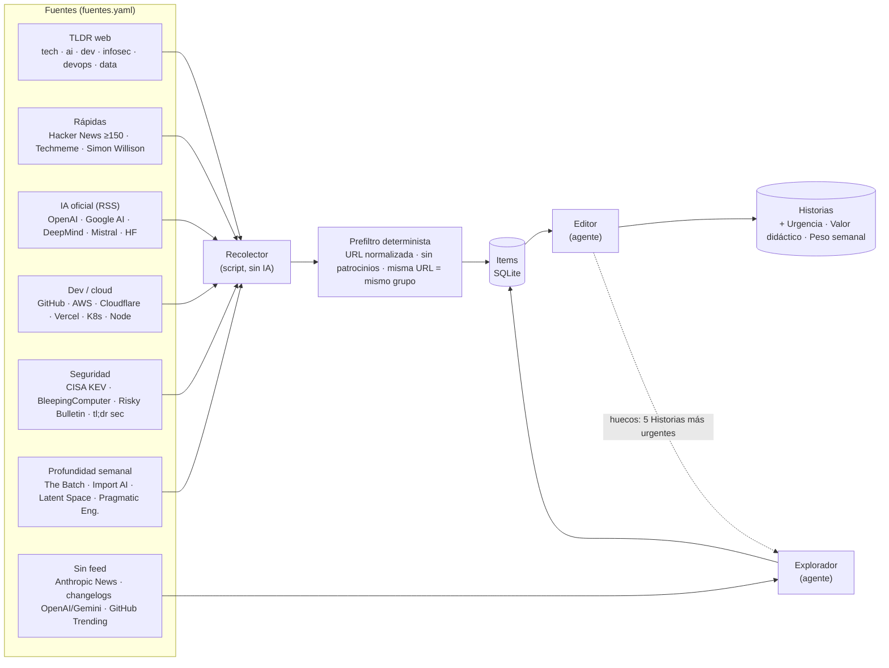
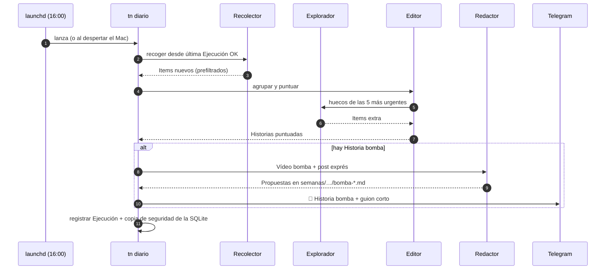
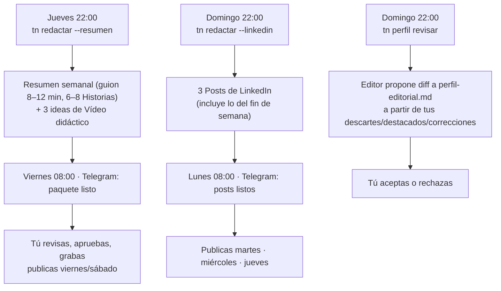
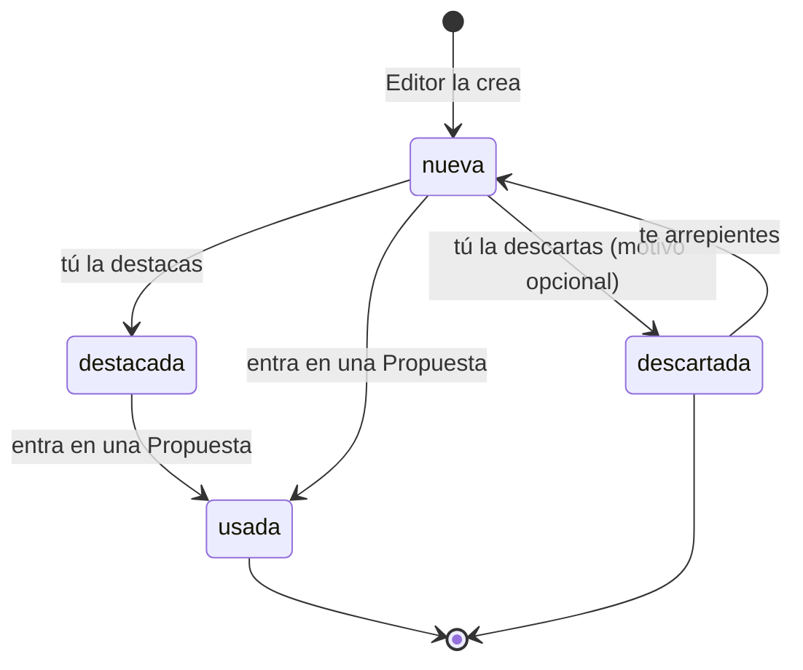
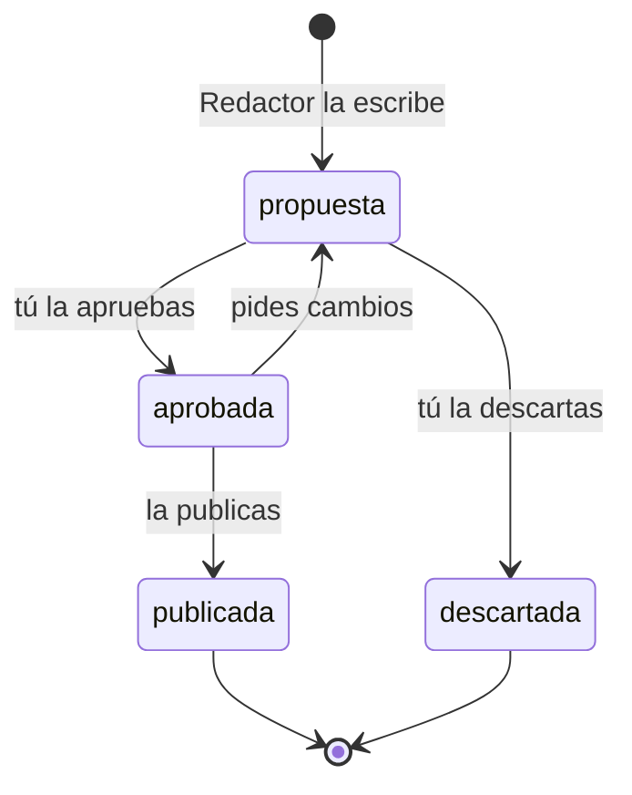

# El arnés de tech-news

Fuente de verdad de **cómo funciona el sistema**: qué entra, quién lo procesa, cuándo, qué sale y cómo intervienes tú. El vocabulario está en [GLOSSARY.md](../GLOSSARY.md) y las decisiones de fondo en [docs/adr/](adr/). Si algo de aquí deja de ser cierto, se corrige aquí primero.

Vista visual (canvas): [Arnés tech-news](https://claude.ai/artifact/FSAwQQcw4d2sJ8ghapZCgk). Si discrepa de este documento, manda este documento.

> Estado: **diseño cerrado, nada construido todavía.** Los nombres de comandos son los previstos y pueden ajustarse al implementar; si cambian, se cambian aquí.

## 1. Visión en una frase

Cada día el sistema recoge lo publicado en ~25 Fuentes, lo agrupa en Historias y las puntúa contra tu Perfil editorial; cada semana convierte las mejores en Propuestas (guiones y posts) que tú apruebas, grabas y publicas. Nada se publica sin ti.

| Fase | Qué cubre | Estado |
|---|---|---|
| **1** | Recoger → Historias → Propuestas (guiones, posts) + interfaz web + avisos | Por construir |
| **2** | Montaje del vídeo: el Montador convierte guion + tu grabación en vídeo editado | Por diseñar (ver §9) |
| **3** | Creación del canal de YouTube (nombre, identidad, configuración) | Pendiente |

## 2. Mapa de entradas



Reglas de entrada:
- **Web/RSS primero.** Gmail queda fuera de la v1 ([ADR-0001](adr/0001-recoleccion-hibrida-scripts-y-agente.md)).
- **Recolector y Explorador solo añaden Items**; nunca interpretan. Editor y Redactor solo interpretan; nunca recogen. Así se puede re-procesar una semana entera sin volver a recoger.
- **Recogida "desde la última Ejecución con éxito"**, no "últimas 24 h": si el Mac estuvo apagado, el hueco se rellena solo ([ADR-0002](adr/0002-ejecucion-local-sin-despliegue.md)).
- Detalle de cada Fuente y cómo leerla: [docs/research/fuentes.md](research/fuentes.md).

## 3. Roles

| Rol | Tipo | Entrada | Salida | Gasta cuota Claude |
|---|---|---|---|---|
| **Recolector** | Script Python | `fuentes.yaml` | Items (prefiltrados) | No |
| **Explorador** | Skill de Claude Code | Lista fija sin feed + 5 Historias más urgentes | Items | Sí (acotado) |
| **Editor** | Skill de Claude Code | Items nuevos + `perfil-editorial.md` | Historias puntuadas, aviso de Historia bomba | Sí |
| **Redactor** | Skill de Claude Code | Historias de la Semana editorial + `voz.md` | Propuestas en `semanas/` | Sí |
| **Montador** | Fase 2 | Guion aprobado + tu grabación | Vídeo editado | Por diseñar |

Tareas cerradas del **Explorador** cada día:
1. Revisar las Fuentes sin feed: Anthropic News, changelog API OpenAI, changelog API Gemini, GitHub Trending.
2. Para las 5 Historias con más Urgencia del día, buscar anuncio oficial o fuente primaria que aún no tengamos.

Trabajo del **Editor** en cada Ejecución:
1. Agrupar Items nuevos: sumar a una Historia abierta o crear una nueva.
2. Leer la fuente original solo de las Historias candidatas (~10–15/día).
3. Puntuar Urgencia, Valor didáctico y Peso semanal, con una línea de justificación cada una.
4. Si alguna Historia es bomba → Redactor exprés (Vídeo bomba + post) y aviso por Telegram.

## 4. Flujos

### 4.1 Diario (16:00)



### 4.2 Semanal



### 4.3 Historia bomba

Se detecta en la Ejecución diaria (máximo un día de retraso, [ADR-0002](adr/0002-ejecucion-local-sin-despliegue.md)). Si ves algo gordo antes, lánzalo tú: `tn diario` o, para una Historia concreta, `tn propuesta pedir <historia> --formato bomba`.

## 5. Horarios

| Cuándo | Qué | Comando | Aviso |
|---|---|---|---|
| Diario 16:00 | Recolector → Editor (+Explorador) → bomba si procede → backup | `tn diario` | Solo si hay Historia bomba |
| Jueves 22:00 | Redactor: Resumen semanal + ideas de Vídeo didáctico | `tn redactar --resumen` | Viernes 08:00 |
| Domingo 22:00 | Redactor: 3 Posts de LinkedIn | `tn redactar --linkedin` | Lunes 08:00 |
| Domingo 22:00 | Editor: propuesta de cambios al Perfil editorial | `tn perfil revisar` | Con el aviso del lunes |

**Semana editorial:** de viernes a jueves. La carpeta de una semana se nombra por su viernes de inicio: `semanas/2026-11-20/` contiene los posts entregados el lunes 23 y el Resumen semanal entregado el viernes 27.

Si el Mac duerme a la hora programada, `launchd` lanza la tarea al despertar. Ningún horario es obligatorio: todo se puede lanzar a mano (§7).

## 6. Ciclos de vida

### Historia



- Una Historia sigue **abierta 7 días** desde su último Item; lo que llegue en ese plazo se suma. Después, una continuación es una Historia nueva **enlazada** a la anterior ("seguimiento de…").
- Correcciones posibles en cualquier estado: ajustar una puntuación, fusionar dos Historias, separar una en dos.

### Propuesta



Las ideas de Vídeo didáctico se proponen como esquema; el guion completo solo se escribe al aprobar una (ahorra cuota).

## 7. Cómo intervienes tú

Toda acción pasa por la CLI `tn` ([ADR-0004](adr/0004-cli-unica-como-punto-de-entrada.md)). La web y yo (Claude Code) somos clientes de esa CLI: **pedírmelo hablando es exactamente lo mismo que pulsar el botón**, y queda registrado igual.

| Quiero… | CLI | Hablando con Claude Code | Web local (`tn ui`) |
|---|---|---|---|
| Lanzar el día ahora | `tn diario` | `/recoger` o "lanza el día" | Ejecuciones → Lanzar |
| Solo recoger / editar / explorar | `tn recoger` · `tn editar [--max-items N]` · `tn explorar` | "recoge" · "re-edita lo de hoy" | Ejecuciones |
| Ver Historias del día/semana | `tn historias --dias 1` · `tn historias` (7 días) · `tn historia ver <id>` | "¿qué hay hoy?" | Hoy / Semana |
| Descartar una Historia | `tn historia descartar <id> --motivo …` | "descarta la de X, ya está muy contada" | Botón Descartar |
| Destacar una Historia | `tn historia destacar <id>` | "esta tiene que ir sí o sí" | Botón Destacar |
| Corregir una puntuación | `tn historia puntuar <id> --didactico 8` | "esto da para vídeo didáctico" | Editar puntuación |
| Fusionar / separar | `tn historia fusionar <a> <b>` · `tn historia separar <id> --items 3,4 --titulo …` | "estas dos son la misma" | Fusionar / Separar |
| Propuesta fuera de calendario | `tn propuesta pedir <id> --formato …` | "hazme un post de esto ya" | Pedir Propuesta |
| Generar el paquete semanal antes | `tn redactar --resumen` | `/redactar` | Ejecuciones |
| Ver / aprobar / descartar una Propuesta | `tn propuestas` · `tn propuesta ver <fichero>` · `tn propuesta estado <fichero> aprobada` | "apruebo el post 2" | Propuestas |
| Revisar la semana con criterio | — | `/revisar-semana` | — |
| Afinar el Perfil editorial | `tn perfil revisar` | "esta semana sobraba cripto" | — |
| Ver qué ha fallado | `tn ejecuciones` | "¿qué tal fue la última ejecución?" | Ejecuciones / Fuentes |

Toda acción acepta `--origen manual|horario|claude|web` para que el registro diga quién la lanzó (`tn` usa `manual` por defecto; yo uso `claude`). Las correcciones sobre Historias (descartar, destacar, restaurar, puntuar, fusionar, separar) quedan guardadas como decisiones, que alimentan `tn perfil revisar`.

Comandos internos de los agentes, útiles para depurar: `tn editor pendientes` (lo que ve el Editor), `tn editor aplicar` (aplica un lote de decisiones, todo o nada) y `tn item anadir` (lo que usa el Explorador).

Reparto: lo **mecánico** (descartar, aprobar, ver estado) en la web, que no gasta cuota. Lo que requiere **criterio** (revisar la semana, afinar un guion, discutir el perfil) conmigo.

### Interfaz web

Local, arrancada a demanda con `uv run tn ui` (FastAPI + HTMX) en http://127.0.0.1:8765; solo escucha en este Mac. Los botones llaman a las mismas funciones que la CLI con origen `web`, y "Lanzar día" ejecuta `tn diario --origen web` en segundo plano (su salida queda en `data/registros/`). Pantallas:
1. **Hoy / Semana**: Historias ordenadas por puntuación, con justificaciones, Items desplegables y las acciones de §7.
2. **Propuestas**: leer, editar y cambiar estado de las del Paquete semanal.
3. **Fuentes**: cuáles traen Items y cuáles fallan.
4. **Ejecuciones**: registro (cuándo, quién la lanzó, cuántos Items, errores) y botón de lanzar.

## 8. Ficheros y datos

```
tech-news/
├── fuentes.yaml              ← catálogo de Fuentes (editable, sin tocar código)
├── perfil-editorial.md       ← tu criterio; el Editor lo lee siempre
├── voz.md                    ← tu tono; el Redactor lo lee siempre
├── semanas/
│   └── 2026-11-20/           ← una carpeta por Semana editorial (viernes de inicio)
│       ├── resumen-semanal.md
│       ├── ideas-didacticas.md
│       ├── linkedin-1.md … linkedin-3.md
│       └── bomba-<slug>.md
├── data/                     ← fuera de git
│   ├── tech-news.db          ← Items, Historias, puntuaciones, Ejecuciones, decisiones
│   ├── borradores/           ← donde el Redactor deja cada texto antes de `tn redactor guardar --desde`
│   └── registros/            ← salida de lo lanzado desde la web
├── src/tn/                   ← CLI, Recolector, interfaz web
├── .claude/skills/           ← explorador · editor · redactor · revisar-semana
├── launchd/                  ← plists de los horarios
└── docs/                     ← este documento, ADRs, investigación
```

Dos capas ([ADR-0003](adr/0003-dos-capas-de-datos.md)): la **máquina** (SQLite, fuera de git, copia diaria comprimida) y la **humana** (Markdown versionado). Cada Propuesta lleva en su cabecera `estado` y las Historias en que se basa.

## 9. Fase 2: el Montador (por diseñar)

Sí entra en el alcance: el sistema cubrirá desde la noticia hasta el vídeo editado. Idea de partida, a concretar en su propia sesión de diseño:
- Entrada: guion aprobado del Resumen semanal (ya trae sugerencias visuales por bloque) + tu grabación (cámara o voz en off).
- El Montador genera secuencias visuales en HTML (titulares, capturas, gráficos, código) sincronizadas con el guion y las renderiza a vídeo; Gemini (AI Studio) para lo que haga falta (imágenes, voz sintética si no grabas).
- Salida: vídeo editado + miniatura + título y descripción para YouTube.
- Decisiones abiertas: herramienta de render, cómo sincronizar con tu audio, qué se automatiza y qué retocas tú, Shorts verticales.

## 10. Hoja de ruta (fase 1)

1. **Recolector + SQLite + CLI** ([#1](https://github.com/javierpiquerasmartinez/tech-news/issues/1)): `fuentes.yaml`, prefiltro, `tn recoger`, registro de Ejecuciones.
2. **Editor** ([#2](https://github.com/javierpiquerasmartinez/tech-news/issues/2)): skill, agrupación en Historias, tres puntuaciones, `perfil-editorial.md`, Explorador.
3. **Interfaz web** ([#3](https://github.com/javierpiquerasmartinez/tech-news/issues/3)): Hoy/Semana, acciones sobre Historias, Ejecuciones, Fuentes.
4. **Redactor** ([#4](https://github.com/javierpiquerasmartinez/tech-news/issues/4)): skill, `voz.md` (mini entrevista), Formatos, pantalla de Propuestas.
5. **Automatización** ([#5](https://github.com/javierpiquerasmartinez/tech-news/issues/5)): `launchd`, Telegram, backup, `tn perfil revisar`.
